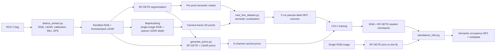

# AI-Based 3D Road-Hazard Detection

An engineering research project that turns vehicle-mounted camera and LiDAR observations into **camera-relative semantic 3D voxel predictions** of road-adjacent hazards. It combines 2D instance segmentation, metric reconstruction, calibrated image-to-voxel lifting, and dense 3D decoding to identify the spatial extent of **loose trash, mud spill, public greenway, and sidewalk**.

The goal is to progress from “a hazard is visible in an image” to a compact 3D representation suitable for future inspection and infrastructure-asset workflows. This is a research pipeline rather than a production road-maintenance system: its 3D labels are model-derived pseudo-ground truth.

> **Current scope:** V10.1 predicts a 5 cm semantic-occupancy volume from RGB and RF-DETR priors. LiDAR creates the labels and acts as privileged training information, but is absent from deployment inference. GPS is extracted and used to filter samples; georeferenced hazard mapping and quantitative severity scoring are not implemented in the checked-in code.

## Contents

- [Highlights](#highlights)
- [System architecture](#system-architecture)
- [Methodology](#methodology)
- [V10.1 3D hazard model](#v101-3d-hazard-model)
- [Repository structure](#repository-structure)
- [Environment and installation](#environment-and-installation)
- [Data preparation](#data-preparation)
- [Training and experiments](#training-and-experiments)
- [Inference and outputs](#inference-and-outputs)
- [Evaluation and visualisation](#evaluation-and-visualisation)
- [Limitations and next steps](#limitations-and-next-steps)
- [Attribution, licensing, and references](#attribution-licensing-and-references)

## Highlights

- **Sensor-to-voxel workflow:** ROS 2 extraction of RGB, LiDAR, calibration, IMU, and GPS; camera/LiDAR time matching and rectified imagery.
- **2D-to-3D pseudo-labelling:** RF-DETR segmentation masks are associated with MapAnything camera-frame points and voxelised per image.
- **Calibrated geometry:** fixed CAM2/CAM6 intrinsics and LiDAR-to-camera transforms, letterbox-aware projection, and metric voxel coordinates.
- **Dense 3D semantic occupancy:** a separate binary occupancy head and four-class semantic head avoid treating background as a semantic hazard class.
- **Deployment path:** RGB plus four RF-DETR foreground probability maps; no LiDAR input is required at inference.
- **Privileged LiDAR training:** a training-only teacher path uses 2D and voxel-aligned LiDAR features, with occupancy and semantic distillation.
- **Ablation coverage:** RGB-only, LiDAR-disabled/RF-DETR-prior, and compact RGB-only 3D U-Net baselines are included.
- **Research traceability:** scripts save temporal splits, checkpoints, metrics, compressed voxel predictions, and held-out evaluation artefacts.

## System architecture



This is the custom road-hazard pipeline. MapAnything is used as a pretrained reconstruction component for pseudo-label generation, not retrained by these scripts. The separately vendored `Scal3R/` framework is not imported by the custom hazard scripts.

## Methodology

### Acquisition, synchronisation, and calibration

[`scripts/fastros_extract.py`](scripts/fastros_extract.py) reads a ROS 2 bag with `rosbags`. It handles three cameras (CAM1, CAM2, CAM6), Velodyne point clouds, IMU, GPS position/velocity, and static transforms. It directly converts the documented BGGR Bayer stream, writes rectified PNG images and PLY point clouds (including intensity when present), and saves calibration/synchronisation/GPS artefacts.

The pseudo-label and V10.1 pipelines process **CAM2 and CAM6** independently. LiDAR is projected with camera-specific intrinsics and fixed LiDAR-to-camera transforms. The voxel convention is `X=right`, `Y=down`, `Z=forward` in the camera frame.

### 2D hazard segmentation

[`scripts/rfdetr_train.py`](scripts/rfdetr_train.py) trains external `RFDETRSegSmall`. The pseudo-label generator uses confidence-thresholded instance masks, resolving overlaps in descending confidence order. It starts with five foreground generator classes:

| Generator ID | Label | V10.1 deployment target |
| --- | --- | --- |
| 0 | fallen fence | Excluded |
| 1 | loose trash | `0` |
| 2 | mud spill | `1` |
| 3 | public greenway | `2` |
| 4 | sidewalk | `3` |

The active model keeps only the last four target classes. Background and fallen-fence channels are deliberately excluded from its deployment input and semantic output.

### Metric reconstruction and pseudo-ground truth

[`scripts/new_fine_dataset.py`](scripts/new_fine_dataset.py) generates the main training targets. For each CAM2/CAM6 image with nearby LiDAR it:

1. projects LiDAR into the calibrated image to form sparse depth;
2. invokes pretrained [MapAnything](https://github.com/facebookresearch/map-anything) with RGB, intrinsics, sparse `depth_z`, and metric scale;
3. obtains camera-relative `pts3d_cam` and a validity mask;
4. transfers RF-DETR’s per-pixel class decision to reconstructed points; and
5. bins points into a fixed semantic voxel grid.

The source region is `X=[-8, 8] m`, `Y=[0, 2] m`, `Z=[0.25, 10] m` at **5 cm**: `320 × 40 × 195` voxels. Labels are `-1` unobserved, `0` observed non-hazard, and `1..5` generator semantic classes. A voxel with several class-labelled points receives the majority class. Each compressed NPZ stores the semantic grid, observed-point occupancy, voxel geometry, camera, timestamp, source image path, and class names.

This is pseudo-ground truth, not independent surveyed 3D annotation. It inherits segmentation/reconstruction error, occlusion, sparse-LiDAR coverage, and the fixed local region of interest.

### Cached RF-DETR and LiDAR priors

[`scripts/generate_priors.py`](scripts/generate_priors.py) produces a matched 8-channel prior per frame:

- channels 0–5: RF-DETR background plus five generator classes;
- channel 6: normalised projected LiDAR depth; and
- channel 7: LiDAR support/confidence after dilation and blur.

Priors are letterboxed to `192 × 192` and saved as NPZ files. The script can save raw-resolution LiDAR overlays from the same projection arrays for calibration inspection. V10.1 uses RF-DETR channels 2–5 as its inference input and reserves the two LiDAR channels for the teacher path.

### GPS usage

GPS is extracted by `fastros_extract.py`. [`scripts/filter_gps_npzs.py`](scripts/filter_gps_npzs.py) nearest-matches NPZ timestamps to GPS (100 ms tolerance), copies samples outside a configured exclusion polygon, and writes a CSV audit log. It is a **dataset filter**, not a world-coordinate transformation, multi-frame fusion process, or map exporter.

### Model variants

| Script | Role | Deployment inputs |
| --- | --- | --- |
| [`scripts/optimised_trainer.py`](scripts/optimised_trainer.py) | Main V10.1 training | RGB + RF-DETR |
| [`scripts/standalone_infer.py`](scripts/standalone_infer.py) | Single-image V10.1 inference | RGB + RF-DETR |
| [`scripts/run_heldout_test.py`](scripts/run_heldout_test.py) | Held-out V10.1 evaluation | RGB + RF-DETR / cached prior |
| [`scripts/prior_ablation.py`](scripts/prior_ablation.py) | RGB-only ablation | RGB only |
| [`scripts/lidar_ablation.py`](scripts/lidar_ablation.py) | LiDAR teacher/distillation ablation | RGB + RF-DETR |
| [`scripts/train_and_infer_3d_unets.py`](scripts/train_and_infer_3d_unets.py) | Compact U-Net / ResU-Net baselines | RGB only |

Several files are experimental version snapshots (`infer_optimised.py`, `run_heldout_test.py`, `lidar_ablation_infer.py`, and `rgb_only_infer.py`). This README reflects static source inspection; no training or inference was run while preparing it.

## V10.1 3D hazard model

No class literally named `3DHazardNet` appears in the repository. The active custom network is `RGBPriorToSemanticVoxelModelV10` in [`scripts/optimised_trainer.py`](scripts/optimised_trainer.py), and is described below as the project’s 3D hazard model.

### Inputs, region, and outputs

Inputs are a `384 × 384` letterboxed RGB image, four `192 × 192` RF-DETR foreground probability maps, camera ID, and letterbox metadata. Training additionally receives the two LiDAR prior maps. The source pseudo-label grid is cropped in memory from `320 × 40 × 195` to `320 × 30 × 195`, retaining `Y=[0, 1.5] m`.

The network outputs one binary foreground-occupancy logit and four semantic logits per target voxel. There is no background semantic class: at inference an empty voxel is stored as semantic value `255`; otherwise semantic argmax yields one of the four target classes.

### Architecture

1. **Image backbone:** ImageNet-initialised ResNet-50 creates C2/C3/C4 features; projections and fusion form a multi-scale feature pyramid.
2. **RF-DETR fusion:** separate prior encoders inject the four probability maps at P2, P3, and P4, retaining fine semantic evidence.
3. **Calibrated 2D→3D lift:** Fourier-encoded metric voxel centres are projected through a camera-specific, letterbox-aware pinhole model. `grid_sample` reads P2/P3/P4 features at those locations; a learned gate merges image evidence, position encoding, and a camera embedding into a `40 × 8 × 20` latent volume.
4. **LiDAR teacher:** training-only LiDAR features are both fused in 2D and projected directly to the latent volume by `LiDARVoxelGeometryLift`. This branch is gated out in student/deployment inference.
5. **Explicit semantic lift:** RF-DETR probabilities are projected into the latent grid and added as a confidence-preserving log prior to semantic logits. Low total foreground mass stays weak rather than becoming a uniform semantic prediction.
6. **3D decoder:** residual 3D blocks and trilinear upsampling decode `40 × 8 × 20 → 80 × 16 × 40 → 320 × 30 × 195`. Separate `1×1×1` occupancy and semantic heads are complemented by a coarse semantic deep-supervision head.

### Losses and sampling

Every non-target voxel—including unobserved MapAnything locations—is deliberately an empty occupancy target. Semantic classification is supervised only at observed target-class voxels. The multitask objective combines asymmetric hard-negative focal occupancy loss, weighted semantic cross-entropy/focal/Dice losses, coarse semantic supervision, and warm-started LiDAR-teacher distillation. A `WeightedRandomSampler` upweights images containing rare loose-trash or mud-spill classes by presence, not raw voxel count. Checkpoint selection uses validation foreground mIoU, never the held-out partition.

## Repository structure

```text
.
├── scripts/                         # Custom extraction, labels, priors, training, inference, analysis
│   ├── fastros_extract.py            # ROS 2 RGB/LiDAR/IMU/GPS/calibration extraction
│   ├── new_fine_dataset.py           # MapAnything + RF-DETR semantic-voxel pseudo-labels
│   ├── generate_priors.py            # Cached RF-DETR/LiDAR priors
│   ├── optimised_trainer.py          # Main V10.1 training
│   ├── standalone_infer.py           # Deployment-style single-image inference
│   └── run_heldout_test.py           # Held-out metrics and diagnostics
├── *.slurm                           # HPC generation/training/ablation launch scripts
├── mapanything/                      # Upstream MapAnything framework
├── configs/, bash_scripts/           # Upstream Hydra training config and launch scripts
├── data_processing/, benchmarking/   # Upstream WAI data/benchmark tooling
├── Scal3R/                           # Separate upstream scalable reconstruction framework
├── rfdetr_inference/                 # Present but no tracked implementation files found
├── unet_experiment/                  # Experiment split artefact
├── tests/                            # Upstream MapAnything tests
├── pyproject.toml, setup.py          # MapAnything package metadata
└── LICENSE                           # Root Apache-2.0 licence text
```

`mapanything/`, `configs/`, `bash_scripts/`, `data_processing/`, `benchmarking/`, and `tests/` are predominantly upstream MapAnything code. The road-hazard contribution is concentrated in root SLURM scripts and `scripts/`.

## Environment and installation

### Baseline package

The root package metadata declares Python `>=3.10` and MapAnything dependencies. Install a CUDA-compatible PyTorch build appropriate to the target machine, then install the repository:

```bash
git clone <repository-url>
cd FYP

# Create/activate a supported Python environment and install PyTorch for your CUDA platform first.
python -m pip install -e .
```

Optional MapAnything extras are defined in [`pyproject.toml`](pyproject.toml), including `.[colmap]` and `.[all]`. Consult the included upstream [training guide](train.md) and [data-processing guide](data_processing/README.md) for original MapAnything workflows.

### Project-specific requirements

The hazard scripts import packages not fully pinned by the root metadata:

| Stage | Requirements evident from source |
| --- | --- |
| RF-DETR | API-compatible `rfdetr` exposing `RFDETRSegSmall` and a trained checkpoint |
| ROS extraction | `rosbags`, SBG ROS message definitions, OpenCV, NumPy |
| GPS filtering | `pandas`, `matplotlib` |
| V10.1 training/inference | PyTorch, TorchVision, Pillow, NumPy, CUDA; RF-DETR for live priors |
| Label generation | MapAnything dependencies and access to `facebook/map-anything` pretrained weights/cache |

Private data, RF-DETR checkpoints, pseudo-labels, and V10.1 weights are not included. Custom scripts embed machine-local paths; configure paths, calibration, and checkpoint compatibility before execution.

### Hardware

MapAnything/RF-DETR label generation uses GPU. V10.1 requires CUDA and dense 5 cm volumes. The supplied SLURM jobs request one L40S GPU, 32 CPU cores, 128 GB RAM, and 24–48 hours, so this should be treated as a GPU/HPC workflow rather than an ordinary laptop demo.

## Data preparation

The following order reflects actual input/output contracts. Paths are intentionally symbolic.

1. Configure and run [`scripts/fastros_extract.py`](scripts/fastros_extract.py) for a ROS 2 bag with expected image, LiDAR, IMU, GPS, and TF topics.
2. Validate CAM2/CAM6 RGB-LiDAR calibration; `generate_priors.py` can create projection overlays.
3. Configure and run [`scripts/new_fine_dataset.py`](scripts/new_fine_dataset.py) with the dataset root and RF-DETR checkpoint to create per-image semantic voxel NPZs.
4. Optionally run [`scripts/filter_gps_npzs.py`](scripts/filter_gps_npzs.py) to apply its configured exclusion-polygon filter.
5. Run [`scripts/generate_priors.py`](scripts/generate_priors.py) to create matched eight-channel prior NPZs.

The main trainer treats the prior directory as the master index, matching each prior by camera/timestamp to the semantic target and using the source-image path stored in that target.

## Training and experiments

The verified main entry point is [`scripts/optimised_trainer.py`](scripts/optimised_trainer.py):

```bash
python scripts/optimised_trainer.py \
  --epochs 50 \
  --batch_size 1 \
  --workers 4
```

It also supports `--lr`, `--overfit_test`, `--no_sampler`, and `--resume [CHECKPOINT]`. Defaults contain experiment-specific dataset/output paths, so adapt those before running. Samples are temporally split independently for each camera: 80% train, 10% validation, 10% test.

[`run_optimised.slurm`](run_optimised.slurm), [`run_lidar_ablation.slurm`](run_lidar_ablation.slurm), and [`run_prior_ablation.slurm`](run_prior_ablation.slurm) launch the corresponding GPU jobs, but contain site-specific module, conda, and directory values that must be adapted outside the original HPC environment.

For RGB-only baseline comparison, [`scripts/train_and_infer_3d_unets.py`](scripts/train_and_infer_3d_unets.py) exposes:

```bash
python scripts/train_and_infer_3d_unets.py \
  --model image2voxel_resunet \
  --epochs 50
```

No numerical results are quoted here: the repository does not contain a reliable tracked experiment summary from which to report them.

## Inference and outputs

[`scripts/standalone_infer.py`](scripts/standalone_infer.py) is the most self-contained V10.1 path. It takes one RGB image, a CAM2/CAM6 selection, a V10.1 checkpoint, and an RF-DETR checkpoint; it generates the RF-DETR prior on the fly and disables LiDAR:

```bash
python scripts/standalone_infer.py \
  --image /path/to/image.png \
  --cam CAM2 \
  --checkpoint /path/to/v10_1_checkpoint.pth \
  --rfdetr_checkpoint /path/to/rfdetr_checkpoint.pth \
  --output /path/to/inference_output
```

The command is verified against the argument parser but was not run during this documentation work. The selected camera must be compatible with the model/calibration.

For `image.png`, output is:

```text
<output>/CAM2_image/
├── image_original.png
├── rfdetr_prior.npz
├── prediction.npz
└── metadata.json
```

`prediction.npz` includes semantic labels, continuous and binary occupancy, semantic confidence/probabilities, voxel geometry, camera/image metadata, class names, and occupancy threshold. Semantic values `0..3` are target classes and `255` denotes predicted empty space.

The repository also retains upstream MapAnything tools for image/multimodal reconstruction, COLMAP/GLB export, and Rerun visualisation: [`scripts/demo_colmap.py`](scripts/demo_colmap.py), [`scripts/demo_inference_on_colmap_outputs.py`](scripts/demo_inference_on_colmap_outputs.py), and [`scripts/visualize_colmap_format_in_rerun.py`](scripts/visualize_colmap_format_in_rerun.py). These are not a complete road-hazard reporting interface.

## Evaluation and visualisation

Training logs occupancy precision/recall/F1 plus foreground and small-hazard mIoU. It saves periodic compressed test predictions but does not use test results for checkpoint selection.

[`scripts/run_heldout_test.py`](scripts/run_heldout_test.py) supports held-out selection from an original test log or temporal split and deployment-style inference without LiDAR. Its outputs include:

- exact voxel occupancy precision, recall, and F1;
- foreground-conditioned per-class IoU/mIoU at reference foreground positions;
- class-agnostic nearest-occupied-voxel matching at 5, 10, and 20 cm; and
- non-overlapping coarse-cell occupancy overlap at 10, 20, and 40 cm.

The evaluator explicitly identifies its reference as MapAnything-derived pseudo-ground truth. Its optional post-hoc translation alignment is kept separate from the unbiased held-out summary and is not used for model selection.

No project-specific hazard figures are tracked in the repository, so this README intentionally does not display unreproducible generated images. Existing visual outputs include LiDAR projection overlays, compressed voxel volumes for external viewers, upstream Rerun/COLMAP tooling, and the separate `Scal3R/` camera/point-cloud visualisation utilities.

## Limitations and next steps

### Established limitations

- Labels depend on RF-DETR and MapAnything rather than manually verified dense 3D ground truth.
- The output is a fixed, camera-relative local grid; predictions are not globally fused or georeferenced.
- “Hazard” covers only four RF-DETR-derived road-environment classes, not a general safety ontology.
- Unobserved reconstruction regions are intentionally trained as empty occupancy, which can bias learning under incomplete coverage.
- The workflow is camera/calibration specific (CAM2/CAM6) and depends on compatible image geometry.
- No code converts voxel outputs to severity, repair priority, depth/area estimates, or asset-management actions.
- GPS currently supports filtering only; no map layer, frame association, or geo-export is implemented.
- Private data/checkpoints and machine-local constants limit out-of-the-box reproducibility.

### Future work

- Obtain manually verified 3D labels and evaluate against independent geometric measurements.
- Package paths, dependencies, calibration, and experiment manifests into portable configuration.
- Fuse temporally adjacent predictions with vehicle poses/GPS into an uncertainty-aware world-frame map.
- Derive and validate severity using measured 3D extent, depth, persistence, and confidence.
- Publish fixed route-level evaluation results and qualitative examples for each ablation.

## Attribution, licensing, and references

### Third-party frameworks

- **MapAnything:** the upstream [MapAnything](https://github.com/facebookresearch/map-anything) framework provides the reconstruction model and broad training/data-processing infrastructure. The project calls `MapAnything.from_pretrained("facebook/map-anything")` for camera-frame pseudo-label reconstruction; MapAnything is not claimed as original project work.
- **Scal3R:** [`Scal3R/`](Scal3R/README.md) is a separately vendored large-scale reconstruction project. It has its own code/docs and is not directly called by the hazard scripts.
- **RF-DETR:** the 2D component depends on external `RFDETRSegSmall` software and a checkpoint not distributed here.
- **Other adapters:** the MapAnything tree includes research integrations for VGGT, DUSt3R, MASt3R, MUSt3R, Pi3, MoGe, AnyCalib, and others. Their presence does not make them components of this road-hazard model.

The upstream MapAnything distribution acknowledges [DUSt3R](https://github.com/naver/dust3r), [MASt3R](https://github.com/naver/mast3r), [RayDiffusion](https://github.com/jasonyzhang/RayDiffusion), [MoGe](https://github.com/microsoft/moge), [VGGSfM](https://github.com/facebookresearch/vggsfm), [VGGT](https://github.com/facebookresearch/vggt), [MaRePo](https://github.com/nianticlabs/marepo), and [DINOv2](https://github.com/facebookresearch/dinov2). MapAnything’s WAI/UniCeption data and training infrastructure remains in this repository under its upstream terms.

### Licensing

The root [`LICENSE`](LICENSE) contains Apache License 2.0 text for the supplied MapAnything distribution. `Scal3R/` has a separate [MIT licence](Scal3R/LICENSE). External models, checkpoints, datasets, and integrations may have independent conditions; consult their original repositories/model cards before redistribution or commercial use. This README does not assert one licence for all third-party assets.

### References

```bibtex
@inproceedings{keetha2026mapanything,
  title={{MapAnything}: Universal Feed-Forward Metric {3D} Reconstruction},
  author={Nikhil Keetha and Norman M\"{u}ller and Johannes Sch\"{o}nberger and Lorenzo Porzi and Yuchen Zhang and Tobias Fischer and Arno Knapitsch and Duncan Zauss and Ethan Weber and Nelson Antunes and Jonathon Luiten and Manuel Lopez-Antequera and Samuel Rota Bul\`{o} and Christian Richardt and Deva Ramanan and Sebastian Scherer and Peter Kontschieder},
  booktitle={International Conference on 3D Vision (3DV)},
  year={2026},
  organization={IEEE}
}

@misc{xie2026scal3rscalabletesttimetraining,
  title={Scal3R: Scalable Test-Time Training for Large-Scale 3D Reconstruction},
  author={Xie, Tao and Yang, Peishan and Jin, Yudong and others},
  year={2026},
  eprint={2604.08542},
  archivePrefix={arXiv}
}
```

See the upstream [MapAnything repository](https://github.com/facebookresearch/map-anything) and [Scal3R README](Scal3R/README.md) for complete framework documentation, acknowledgements, and citations.
